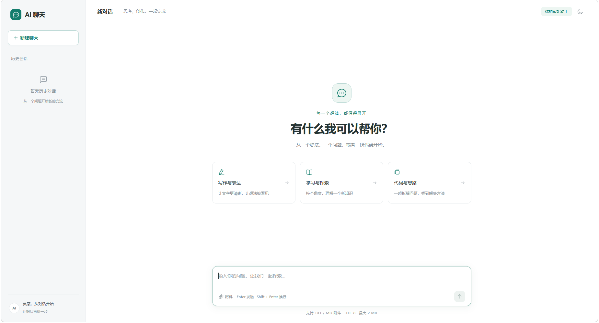

# AI聊天应用教程

基于 Vue 3 + Node.js 的 AI 聊天教学项目，通过火山方舟调用聊天与豆包向量模型，支持流式对话和 TXT/MD 文件检索问答。

## 功能

- **流式对话**：支持上下文，逐步显示回复；空回复可重试，连接中断或输出截断时保留已有正文。
- **多会话管理**：首条有效消息发送时创建会话，支持切换和删除；各自保存草稿与生成状态，切换不中断回复，聊天记录在本地持久化。
- **文件问答**：点击附件按钮或拖入 TXT/MD，建立向量索引后可连续追问，并展开引用原文；上传失败可重试。
- **Markdown 展示**：支持代码高亮、表格、复制代码与完整回复。
- **界面适配**：支持窄屏抽屉导航和日夜主题，主题选择自动保存。

## 快速开始

需要 **Node.js 22.12+** 和已开通聊天模型的火山方舟账号；文件问答还需开通向量模型。以下命令均在项目根目录执行。

### 1. 安装依赖

```bash
npm install
npm --prefix backend install
```

### 2. 配置模型

将 [backend/.env.example](backend/.env.example) 复制为 `backend/.env`，填写自己的密钥与已开通的聊天模型 ID：

```env
ARK_API_KEY=your-api-key
ARK_MODEL_ID=your-enabled-model-id
```

文件问答默认使用 `doubao-embedding-vision-251215`、1024 维向量，沿用同一 API Key。其他可选配置见 [后端配置](backend/README.md#配置)。

### 3. 启动服务

终端一启动后端：

```bash
npm --prefix backend run dev
```

终端二启动前端：

```bash
npm run dev
```

默认后端地址为 `http://localhost:3000`，浏览器访问 `http://localhost:5173`。同一端口只启动一份后端，重启前先在原终端按 Ctrl+C。

## 技术栈与目录

| 层次       | 技术                                                       |
| ---------- | ---------------------------------------------------------- |
| 前端       | Vue 3、Vite、Element Plus、Pinia、Vue Router               |
| 样式与内容 | Tailwind CSS 4、SCSS、markdown-it、highlight.js            |
| 后端       | Node.js、Express 5、原生 Fetch / Web Streams、官方 MCP SDK |

```text
├── src/
│   ├── layout/、views/      # 聊天布局与页面
│   ├── components/
│   │   ├── common/         # Markdown、复制按钮、主题切换
│   │   └── chat/           # 侧栏、消息、输入框与附件
│   ├── stores/             # 会话与主题状态
│   ├── services/           # 聊天请求、SSE 解析与文件上传
│   ├── utils/              # Markdown、高亮、剪贴板与存储
│   └── styles/             # Tailwind 入口与全局 SCSS
├── backend/                # HTTP 服务、模型调用与 MCP 文档检索
└── tests/                  # 前端状态、组件与请求测试
```

学习代码可从以下文档开始：

- [前端开发说明](docs/frontend.md)：组件职责、消息流转、样式约定、Markdown 与持久化。
- [后端开发说明](backend/README.md)：代码结构、配置、HTTP 接口、向量检索与外部 MCP 接入。

## 使用限制

| 项目     | 当前行为                                                                                                                                      |
| -------- | --------------------------------------------------------------------------------------------------------------------------------------------- |
| 文件格式 | 仅支持 UTF-8 编码的 TXT/MD，最大 2 MB，每个会话一个文件；已发送的附件需新建聊天才能更换。PDF、Word、图片及 CSV/JSON 分析尚未实现。            |
| 上传处理 | 建立索引会调用向量模型并消耗额度，不调用聊天模型；默认处理期限为 5 分钟。                                                                     |
| 聊天记录 | 保存在当前浏览器的 `localStorage`，不跨设备同步。刷新会停止生成并保留已有文字，恢复已有会话及附件关联；空白新聊天中未发送的附件需重新选择。 |
| 后端文件 | 原文件、分块和向量保存在后端磁盘，可跨重启保留；删除本地会话不会立即删除后端文件。                                                            |
| 索引兼容 | 旧文档缺少兼容向量，或更换向量模型、维度、检索指令版本后，需新建聊天并重新上传；不自动重建索引。相关错误码为 `DOCUMENT_REINDEX_REQUIRED`。  |

## 验证与构建

```bash
npm test
npm --prefix backend test
npm run build
```

测试使用模拟模型响应，不消耗 API 额度；真实模型的权限、连通性和检索效果需另行验证。

构建产物位于 `dist/`，后端可用 `npm --prefix backend start` 启动。部署到其他地址时，需调整 [聊天请求](src/services/chat.js) 和 [文件上传](src/services/files.js) 中写死的 `http://localhost:3000`。当前版本面向本地开发，尚未接入登录和多用户授权。

## 常见问题

| 问题                 | 排查方式                                                                                              |
| -------------------- | ----------------------------------------------------------------------------------------------------- |
| API 请求失败         | 检查后端是否启动、`backend/.env` 中的密钥与模型 ID、模型是否已开通，并查看后端日志。                |
| 流式回复没有正文     | 查看页面错误和浏览器网络请求；使用“重试回复”可复用原问题与附件。                                    |
| 修改样式配置后不生效 | 调整 Vite 插件或安装依赖后重启开发服务；Tailwind 编译检查见[前端开发说明](docs/frontend.md#样式约定)。 |

## 贡献与许可证

欢迎通过 Issue 或 Pull Request 改进项目。MIT License。
